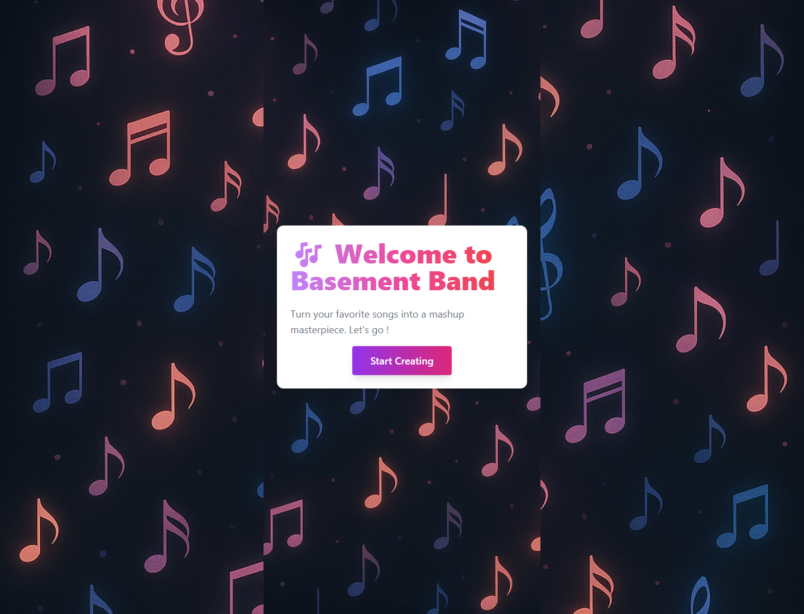
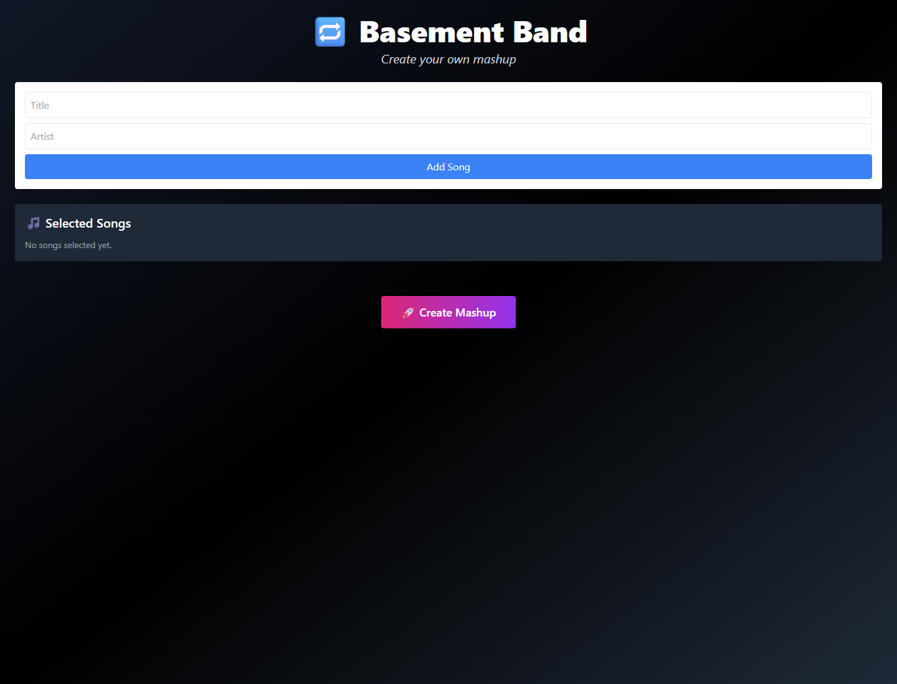
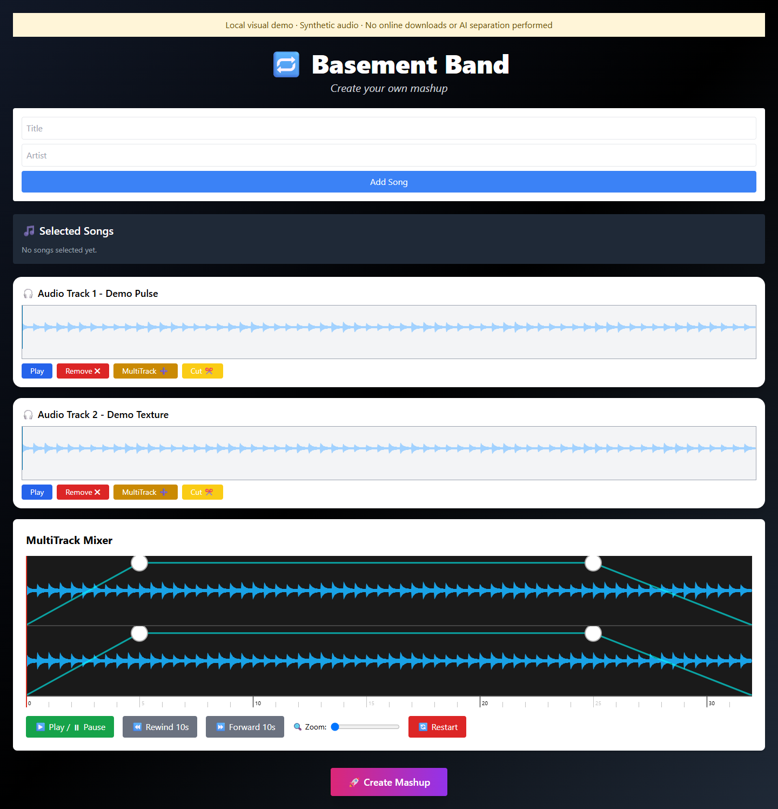
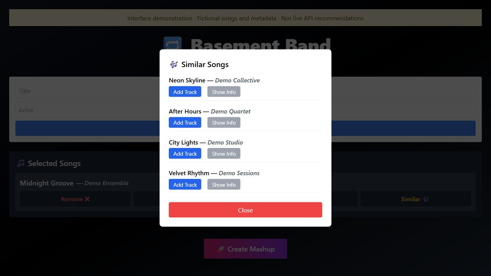
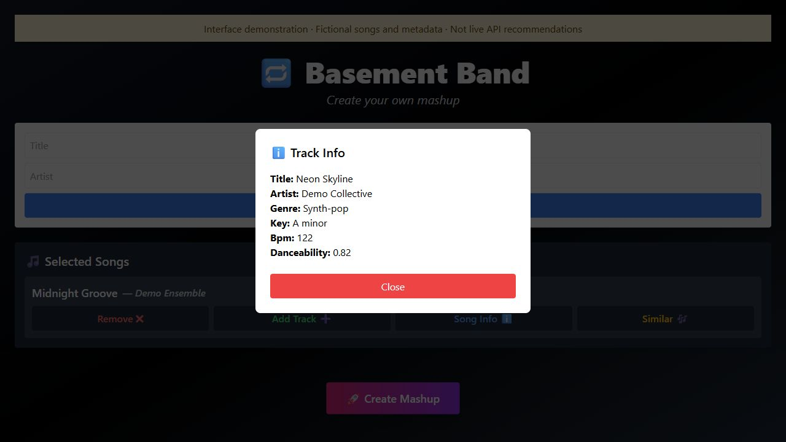
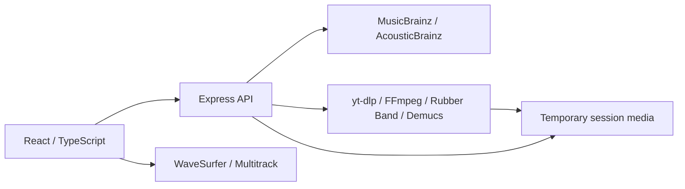

<div align="center">

# Basement Band

### Discover tracks. Explore stems. Build a mashup.

An academic team project combining music discovery with a visual audio workspace.

**TypeScript · React · Vite · Tailwind CSS · Node.js · Express · WaveSurfer.js · Demucs**

[Screenshots](#screenshots) · [Architecture](docs/ARCHITECTURE.md) · [Local setup](docs/SETUP.md) · [Team](#team)



</div>

## The project

**Basement Band** is the application developed for the **Music Mashup** project in **COMPX241-25A · Software Engineering Design 1**, at **The University of Waikato (2025)**. It brings together song search, musical metadata, waveform playback and a multitrack workspace. The backend integrates audio tools for downloading source material, adjusting tempo, cutting clips and separating vocals, drums, bass and other instruments.

This repository preserves an academic prototype. It includes the original application code, its collaborative history and documentation of the implemented workflow. Audio processing depends on external services and locally installed tools; a successful frontend build does not establish that the complete processing pipeline works.

## Screenshots

<table>
  <tr>
    <td align="center"><a href="docs/screenshots/editor.png"></a></td>
    <td align="center"><a href="docs/screenshots/mixer-demo.png"></a></td>
  </tr>
  <tr><td align="center">Search and selection workspace</td><td align="center">Waveforms and multitrack mixer · synthetic audio demo</td></tr>
  <tr>
    <td align="center"><a href="docs/screenshots/similar-songs-demo.jpg"></a></td>
    <td align="center"><a href="docs/screenshots/track-info-demo.jpg"></a></td>
  </tr>
  <tr><td align="center">Similar-song selection · fictional example data</td><td align="center">Song metadata · fictional example data</td></tr>
</table>

The welcome screen and empty editor are captures of the original frontend running locally. The populated mixer is a **visual demonstration with two locally generated synthetic audio tracks**, loaded in an isolated temporary copy. It uses the original waveform and mixer components; no online download or Demucs separation was performed for that image. Temporary fixture code and audio are not part of this repository.

The **Similar Songs** and **Track Info** captures show the original dialogs using fictional songs and metadata in an isolated temporary copy. They demonstrate the selection and information interface; they are not live MusicBrainz/AcousticBrainz recommendations. No audio was downloaded for these two captures. Click a capture to view it at full size.

## Implemented areas

| Area | What the prototype contains |
| --- | --- |
| Discovery | Search by title and artist, musical metadata, and similarity queries through MusicBrainz and AcousticBrainz. |
| Selection | Selected-song list, song information dialogs and related-song selection. |
| Waveforms | Audio waveform display, playback controls and clip-cut requests. |
| Multitrack | A visual workspace with draggable tracks, volume envelopes, fades, seeking and zoom. |
| Processing | Backend integration with yt-dlp, FFmpeg, Rubber Band and Demucs. |
| Sessions | Cookie-based temporary workspaces for audio files. |

Some processing options are present in code but disabled in the current combination route, including volume equalisation. See [architecture and API](docs/ARCHITECTURE.md) for the boundaries between the interface and the audio pipeline.

## Team

Developed collaboratively by four students, with responsibilities documented in the project reports and Git history.

| Team member | Role and contribution areas |
| --- | --- |
| Aitana Cantó Rico | **GitHub Project Manager and frontend lead:** repository setup, branch workflow, integration and merge-conflict resolution; React interface, waveform player, multitrack mixer and frontend/backend integration. |
| Frankie Christie | MusicBrainz/AcousticBrainz integration and similar-song route; song information dialogs and shared loading UI. |
| Connor Ford | Audio downloads, session file handling, cutting, tempo adjustment, volume normalisation and the combined processing pipeline. |
| Marvi Karibule | Demucs integration, stem-separation service and its backend route. |

**Project managers:** Sabina Han and Aryan Thanki.

The team used individual branches and a shared integration branch. Aitana coordinated GitHub integration, helped teammates with repository setup and conflicts, and wrote the [team workflow guide](docs/GITHUB_WORKFLOW.md). Responsibilities overlapped during integration.

## Architecture at a glance



## Repository layout

```text
Prototype/
  frontend/
    src/pages/              Welcome page and creation workspace
    src/components/         Search, selection, waveform and multitrack UI
    src/components/ui/      Shared interface elements
    src/components/types/   Frontend data contracts
    public/                 Original static assets
  Backend/
    src/routes/             HTTP endpoints grouped by capability
    src/services/           Metadata and audio-tool integrations
    src/stemSeparation/      Demucs process integration
    src/cookieManagement/   Temporary session handling
    src/types/              Backend data contracts
docs/
  screenshots/              Application captures
  SETUP.md                  Prerequisites and local startup
  ARCHITECTURE.md           Data flow and API reference
  GITHUB_WORKFLOW.md        Original team workflow guide
```

## Run locally

The [setup guide](docs/SETUP.md) describes the two applications and the separate audio dependencies. In the current source, the frontend expects the backend at **localhost:50000**, and the backend allows the Vite origin **localhost:5173**.

For the interface alone:

```sh
cd Prototype/frontend
npm ci
npm run dev
```

Open the URL printed by Vite. Search and processing operations require the backend and their external dependencies.

## Prototype status

The original project report identifies three unfinished areas: exporting the final mashup, shifting songs into a common musical key, and reliable similar-song recommendations. Download and stem-separation latency were also noted. Tempo adjustment is implemented separately from musical-key matching; the mixer provides interactive arrangement and playback rather than a completed export workflow.

The original frontend produced a Vite build and its welcome page and editor rendered locally. Separate TypeScript checks report existing diagnostics in both projects. This presentation update preserves those source files and dependency versions; it does not resolve application defects or establish production readiness. See [setup notes](docs/SETUP.md#validation-boundaries).
