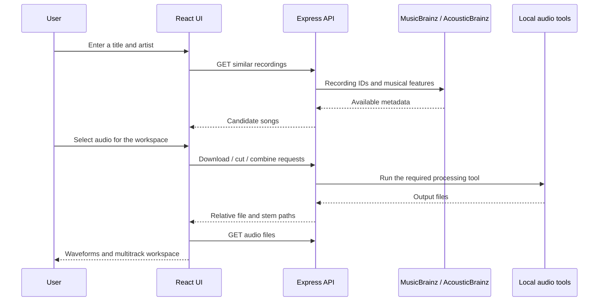

# Architecture and API

## Design context

The 2025 project aimed to bring song discovery, stem separation and manual mashup arrangement into one browser workspace. The React frontend and Express backend run separately: the browser handles interactive playback and arrangement, while backend services retrieve metadata and invoke local audio tools. The design gives users control over track selection, timing, fades and volume.

## Frontend

The React application uses two routes: `Home` at `/` and the creation workspace at `/autogenerate`. `SongSearch` queries the backend, while `SelectedSongs` manages the list and metadata dialogs. `WaveformPlayer` displays audio and optional stems; `MultiTrack` provides the combined timeline with WaveSurfer Multitrack.

The UI and API share similar `Song` contracts: recording identifier, title, artist, key, scale, BPM, other metadata, a relative audio path and optional stem paths. Those contracts are maintained separately in the two applications.

### Workspace components

| Component | Responsibility |
| --- | --- |
| `AutoGenerate.tsx` | Coordinates selected songs, downloaded audio, stems and tracks added to the mixer. |
| `SongSearch.tsx` | Accepts a title and artist and requests related recordings, with loading and fallback states. |
| `SelectedSongs.tsx` | Manages selected songs, metadata dialogs, related candidates and download actions. |
| `WaveformPlayer.tsx` | Displays track and stem waveforms, controls playback, requests timestamp-based cuts and adds audio to the mixer. |
| `MultiTrack.tsx` | Provides the shared timeline, draggable start positions, playback, fades, volume envelopes and zoom. |

React hooks manage component state and audio-player lifecycles. Framer Motion supplies interface transitions. Audio files are fetched from the backend for waveform playback; they are not embedded in the repository.

## Backend

Express applies CORS, JSON parsing, cookie parsing and session middleware before registering routes. Services then invoke metadata APIs or local child processes. Temporary audio is organised into session-specific `raw`, `altered` and `stems` folders.

| Source area | Role |
| --- | --- |
| `src/routes/acousticBrainz/` | Similarity endpoint and metadata orchestration. |
| `src/routes/ytDownloader/` | Download requests. |
| `src/routes/audioManipulation/` | Clip cuts and processing of selected songs. |
| `src/routes/stemSeparation/` | Explicit Demucs endpoint. |
| `src/routes/utility/` | Serving an audio file to the frontend. |
| `src/services/` | MusicBrainz, AcousticBrainz, yt-dlp, FFmpeg and Rubber Band integrations. |
| `src/stemSeparation/` | Demucs invocation and expected stem paths. |
| `src/cookieManagement/` | Session identifiers, temporary folders and cleanup logic. |

## Endpoint map

The following routes are transcribed from the current source, not a guarantee that every path completes successfully.

| Method | Path | Intended response |
| --- | --- | --- |
| GET | `/SimilarSongs/:metric/:title/:artist` | Recording metadata and similar songs, or an error/no result. |
| POST | `/Download/` | Song object with a downloaded audio path. |
| GET | `/GetFile/:filepath` | Audio file for the encoded relative path. |
| POST | `/Cut/:timestamp1/:timestamp2` | Song object with a cut clip path. |
| POST | `/Combine/` | Selected songs with adjusted audio and stem paths. |
| POST | `/api/stem/run-demucs` | Song object with separated stem paths. |

POST processing routes expect song data in JSON. File requests encode a relative path into the URL; browser requests that need the session use credentials. A GET response returns data directly in its HTTP response; the backend does not answer a GET by sending a separate POST request.

## Processing flow

The combination route currently enables tempo adjustment and disables volume equalisation. Its response contains processed song/stem references; it does not itself return a single mastered mashup download. The browser's multitrack component handles the visual arrangement and playback controls.

## Runtime boundaries

The code is an academic prototype with fixed development URLs, local media storage and several unhandled failure paths. Session storage is in memory. It is not described here as a production deployment or an authenticated multi-user service. See [local setup and validation](SETUP.md) before running it.

## Delivery scope and future work

The final group report distinguishes the delivered editor from the original export goal. Exporting a finished mashup and transposing songs into a common musical key remained unfinished. Rubber Band tempo adjustment does not establish that musical-key matching is implemented.

The report also records missing or unreliable similarity data and slow downloads and stem separation. Future work identified by the team includes more reliable discovery, key matching, final export and faster processing. The interface and API descriptions above describe the retained prototype; they do not assert that external services or the complete audio pipeline have been validated today.
